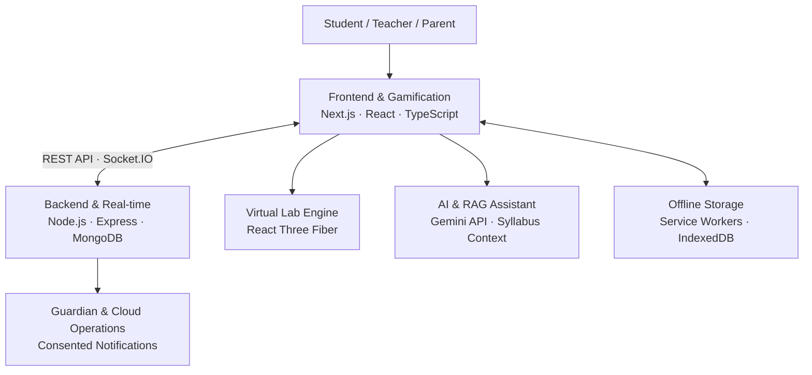

# VIDYAQUEST

  <strong>Learn. Experiment. Grow.</strong> 
  An accessible, AI-assisted learning platform built around interactive virtual laboratories.

  <em>Making practical, engaging science education easier to access for students, schools, and colleges.</em>

---

## 📖 About the Project

**VIDYAQUEST** is a learning platform designed to make academic learning more interactive through gamified experiences, AI-powered academic assistance, and browser-based virtual laboratories.

The platform aims to help students understand concepts beyond textbooks by allowing them to explore simulations, practise at their own pace, and receive learning support aligned with the **NCERT and state-board syllabus**.

It is being designed with students and educational institutions in mind, including environments where access to physical laboratory facilities, devices, or reliable internet may be limited.

## 🎯 The Problem

- Practical learning opportunities can be limited by the availability, cost, or maintenance of physical laboratory equipment.
- Students may struggle to connect textbook concepts with real-world experiments.
- Learning support is not always personalised to a student's syllabus, pace, or level of understanding.
- Intermittent internet connectivity can interrupt access to digital learning resources.
- Parents and educators need clearer visibility into student progress and performance.

## 💡 Our Solution

VIDYAQUEST brings together interactive learning, virtual experiments, and contextual AI support in one platform.

### Core Features

| Feature | What it offers | Planned stage |
|---|---|---|
| **Interactive Learning & Gamification** | Engaging learning interface and gamified student experiences | MVP |
| **Backend & Real-time Services** | APIs, data management, and real-time communication | MVP |
| **AI Learning Assistant** | Gemini-powered assistance with Retrieval-Augmented Generation (RAG), grounded in NCERT/state syllabus content | MVP |
| **Virtual Lab Engine** | Browser-based 3D physics simulations designed for deterministic, repeatable outcomes | MVP / Future expansion |
| **Offline-First PWA** | Service-worker caching and IndexedDB support for access to previously cached learning content | MVP base / Phase 2 |
| **Guardian & Cloud Operations** | Consented WhatsApp Business notifications and cloud deployment/operations | Phase 2 / Future |

> **Note:** The stages above describe the current project plan. They are not a claim that every feature is already implemented or deployed.

## 🧪 Virtual Laboratory Experience

The virtual lab experience is intended to let learners explore scientific concepts through interactive simulations rather than only reading about them.

The planned simulation engine uses **React Three Fiber** and a deterministic 3D physics approach to support consistent experiment outcomes.

## 🤖 AI & RAG Learning Assistant

The AI assistant is planned to provide contextual learning support using the **Gemini API** and **Retrieval-Augmented Generation (RAG)**.

The knowledge context is intended to be aligned with NCERT and state-board syllabus material, helping students get explanations that are relevant to what they are studying.

## 🧱 Technology Stack

| Layer | Technologies |
|---|---|
| Frontend & Gamification | Next.js, React, TypeScript, Tailwind CSS, Phaser.js |
| Backend & Real-time | Node.js, Express.js, MongoDB, Socket.IO |
| Virtual Lab Engine | React Three Fiber, deterministic 3D physics engine |
| AI & RAG | Gemini API, Retrieval-Augmented Generation, NCERT/state syllabus knowledge base |
| Offline-first experience | Progressive Web App (PWA), Service Workers, IndexedDB |
| Guardian communication & operations | WhatsApp Business Cloud API (with user consent), cloud hosting |

## 🏗️ High-Level Architecture

This diagram represents the intended system boundaries and data flows; implementation details may evolve as development progresses.

## 💼 Business Model

VIDYAQUEST is planned around multiple potential revenue channels to support long-term sustainability:

- **Advertising:** Relevant, non-intrusive advertising.
- **Paid virtual labs:** Subscription or paid access to premium simulations and lab resources.
- **Government collaboration:** Partnerships for digital education initiatives and programmes.
- **Third-party technology collaboration:** Integrations and co-development with edtech, AI, cloud, and simulation providers.
- **Institutional services:** Paid deployment, customisation, analytics, and reporting for schools and colleges.
- **Parent services:** Optional paid access to detailed student report cards, performance analytics, attendance, and progress insights.

These are proposed revenue streams and may be refined through pilots, partnerships, and user feedback.

## 🌍 Who Can Benefit?

- **Students:** Interactive learning, virtual experiments, and syllabus-aware academic support.
- **Teachers:** Additional digital resources to support classroom teaching and practical demonstrations.
- **Schools & Colleges:** Potential access to virtual lab resources, deployment options, and student analytics.
- **Parents:** Better visibility into student progress through consent-based reporting services.

## 🔐 Privacy & Responsible Use

- Guardian communication is intended to use the WhatsApp Business Cloud API only with appropriate consent.
- Student performance information should be accessible only to authorised users.
- AI-generated explanations should support learning and should be checked against trusted academic material.
- Any future analytics and reporting features should follow applicable privacy, security, and data-protection requirements.

## 🚧 Development Status

VIDYAQUEST is under development. The technology stack and feature stages in this README reflect the current project plan. As implementation progresses, this section will be updated with verified functionality, screenshots, setup instructions, and deployment links.

## 🛠️ Local Setup

The repository is currently being prepared for the project source code. Installation and run instructions will be added after the application code, package manifests, and environment-variable templates are committed.

Please do not add real API keys, database credentials, or other secrets to the repository. Use environment variables and a local `.env` file (excluded from version control) when configuring integrations.

## 🤝 Contributing

Contributions, suggestions, and feedback are welcome as the project development workflow is established.

1. Fork the repository.
2. Create a feature branch.
3. Make your changes and test them.
4. Open a pull request with a clear description of the changes.

## 📌 Project

**Repository:** [anubhab-cloud/VIDYAQUEST](https://github.com/anubhab-cloud/VIDYAQUEST)

---

  Built with ❤️ to make learning more interactive, accessible, and meaningful.

